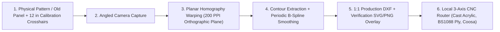

# OrthoBulkhead

**Marine Interior Refit, Surface Remediation & Optical-to-DXF CNC Fabrication Framework (`30–45 ft` Production Cruisers)**

`ortho-bulkhead` (**OrthoBulkhead** — combining *Orthographic* [planar homography optical template-to-DXF rectification] and *Bulkhead* [structural marine joinery, frameless acrylic glazing, and interior architecture]) is an engineering, materials science, and CAD/CAM fabrication project for refitting **`30–36 ft` classic cruisers** and **`40–45 ft` modern production yachts**.

---

## Why OrthoBulkhead?

Traditional yacht interior refits cost `$40,000–$75,000+` because shipwrights spend hundreds of hours hand-spiling curved hull bulkheads, cabin sole panels, and compound-curved acrylic windows in place inside a cramped hull.

**OrthoBulkhead** replaces manual scribing and marine-yard markups with a **Smart Hybrid digital fabrication workflow**:
1. **Planar Homography Camera-to-DXF Pipeline ([`process_window_templates.py`](process_window_templates.py)):** Photograph paper patterns, removed bulkheads, floorboards, or old cabin windows marked with a `4-point` (`12.0" × 12.0"`) calibration grid from any angle. The OpenCV/SciPy pipeline rectifies perspective distortion onto a `200 PPI` orthographic plane, fits smooth periodic B-splines, and exports `1:1` CNC-ready `DXF` and visual verification `SVG/PNG` overlays.
2. **Terrestrial CNC Routing & Commercial Spray Booths:** Outsource flat-pack cutting of **`3/8"` (`9.5 mm`) cell-cast acrylic windows**, **`BS1088` Okoume/Meranti marine plywood**, **`Coosa Bluewater 26` composite bulkheads**, and **`4 mm` `Sintra` headliner panels** to local non-marine CNC router shops (`$100–$150/hr` machine time), and finish cabinet modules off-boat in a residential kitchen cabinet `2K` conversion-varnish spray booth—cutting total refit cost by **`70%–80%`**.
3. **Engineered Remediation & Moisture/Odor Locks:** Protocols for 3-stage smoke/`PAH` and mold decontamination (alkaline `TSP` / `Concrobium` $\rightarrow$ hydroxyl/ozone oxidation $\rightarrow$ `100%` solids epoxy / shellac vapor barrier), overhead `1708` biaxial epoxy re-skinning, `6-side` penetrating-epoxy floorboard encapsulation, and frameless structural window glazing (`3M VHB 4991` + `Sikaflex 295 UV` / `Dow 795`).

---

## Optical-to-CNC Workflow

---

## Repository Contents

* **[`marine-interior-cnc-refit-guide.md`](marine-interior-cnc-refit-guide.md)** — Complete engineering, materials science, remediation, and cost/labor guide (`100% DIY` vs. `Smart Hybrid` vs. `Turnkey Yard`) across both **`40–45 ft` modern production cruisers (`Beneteau Oceanis 40` class)** and **`30–36 ft` classic cruisers (`Hunter 35` class)**.
* **[`process_window_templates.py`](process_window_templates.py)** — Python CLI tool (`OpenCV`, `SciPy`, `ezdxf`, `NumPy`) that rectifies angled template photos using planar homography and exports `1:1` inch-scaled `LWPOLYLINE` and `SPLINE` `DXF` files plus `1:1` visual verification `SVG/PNG` overlays.
* **[`requirements.txt`](requirements.txt)** — Python dependencies (`opencv-python`, `numpy`, `scipy`, `ezdxf`).

---

## Development Roadmap

- [x] **Phase 0: Remediation Protocols, Materials Engineering & Cost/Labor Architecture**
  - Define `100% DIY`, `Smart Hybrid (CNC + Terrestrial Shop)`, and `Turnkey Yard` execution models for `40+ ft` partial refits and `30–36 ft` full-gut refits.
  - Implement [`process_window_templates.py`](process_window_templates.py) planar homography `DXF` & `SVG` generator.
- [ ] **Phase 1: Frameless `3/8"` Cast Acrylic Glazing & Envelope Sealing**
  - Process cabin-top and hull-side window templates into `1:1` `DXF` files, verify dimensional diagonals against physical lenses, CNC-route `3/8"` cell-cast smoked acrylic, and bond with `Sika Primer 209 D` + `3M VHB 4991` + `Sikaflex 295 UV`.
- [ ] **Phase 2: Structural Bulkhead & Modular Headliner CNC Fabrication**
  - Digitize removed bulkhead and aft-cabin joinery panels into `1:1` `DXF` nested sheet layouts (`BS1088 Okoume` and `Coosa Bluewater 26`), including quick-release inspection hatches for parallel-hybrid shaft drives ([`flux-shaft`](https://github.com/boats-boats-boats/flux-shaft)).
  - Fabricate `Fastmount` clip-in insulated vinyl overhead liner panels over `6–13 mm` closed-cell elastomeric hull insulation.
- [ ] **Phase 3: Off-Boat `2K` Cabinet Refinishing, `6-Side` Epoxy Sole & Multi-Density Upholstery**
  - Complete off-boat `2K` conversion varnish / two-tone `Satin Oyster White` + hardwood trim spray finishing, `6-side` penetrating-epoxy sole sealing, and multi-density (`35–45 ILD` HR base + latex topper) cushion fabrication.
