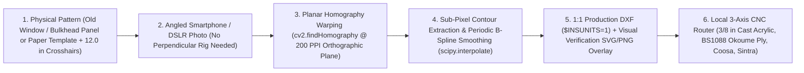

# Marine Interior Refit, Remediation & Optical-to-DXF CNC Fabrication Guide (`30–45 ft` Production Cruisers)

**OrthoBulkhead** (`ortho-bulkhead` — combining *Orthographic* [planar homography optical template-to-DXF rectification] and *Bulkhead* [structural marine joinery, acrylic deadlights, and cabin architecture]) is an engineering, materials science, and CAD/CAM fabrication framework for refitting **`30–36 ft` classic cruisers** and **`40–45 ft` modern production yachts**.

Instead of paying `$40,000–$75,000+` in traditional shipwright hand-scribing labor, `OrthoBulkhead` pairs **2D planar-homography optical templating ([`process_window_templates.py`](process_window_templates.py))** with **local terrestrial CNC routing (`$100–$150/hr` machine time)**, **off-boat commercial cabinet spray booths**, and **engineered marine composites (`BS1088 Okoume`, `Coosa Bluewater 26`, `3/8"` cast acrylic, and `Fastmount` insulated liner panels)**—cutting total refit cost by **`70%–80%`**.

---

## 1. Two Reference Refit Archetypes (`30–36 ft` Classic vs. `40–45 ft` Modern Cruiser)

Most sailboat interior refits fall into one of two structural and materials archetypes:

| Feature | **Archetype A: Classic `30–36 ft` Cruiser (`Hunter 35` Class)** | **Archetype B: Modern `40–45 ft` Cruiser (`Beneteau Oceanis 40` Class)** |
| :--- | :--- | :--- |
| **Typical Refit Trigger** | Long-term window/deck leaks, severe condensation, mold, and rotted structural bulkheads / floorboards. | Localized thermal/smoke/surface damage, crazed panoramic acrylic windows, peeling headliners, or water-damaged aft/galley joinery. |
| **Hull & Liner Construction** | Solid GRP lower hull + balsa-cored deck + molded fiberglass lower settee pan + glued foam-backed vinyl hull liner. | Monolithic GRP hull with bonded structural fiberglass grid tray (`contre-moule`) + balsa/foam-cored deck. |
| **Factory Joinery Material** | Teak-veneered marine plywood + solid teak fiddles, moldings, and louvered doors. | **`Alpi` reconstituted wood veneer (`0.5–0.8 mm`)** dyed fruitwood/mahogany or oak over `Okoume` plywood + solid hardwood fiddles. |
| **Fixed Cabin Windows** | Cabin-top cast acrylic deadlights + plastic opening portlights (`Gray` / `Lewmar`). | Large compound-curved panoramic coachroof and hull-side **`3/8"` (`9.5 mm`) cast acrylic** bonded with structural adhesive. |
| **Key Structural Hazard** | Cutting out rotted main bulkheads without slacking the rig and supporting the mast compression beam causes deck sag. | Belt-sanding thin `0.6 mm` `Alpi` veneer burns through to the plywood core; painting over smoke/PAH or silicone residue causes fisheyes and odor bleed-through. |

---

## 2. Optical Template-to-DXF CNC Pipeline ([`process_window_templates.py`](process_window_templates.py))

Hand-spiling complex curved hull bulkheads, cabin sole floorboards, and panoramic acrylic windows is the single largest labor sink in boatbuilding. `OrthoBulkhead` replaces hand-cutting with a **calibrated camera-to-DXF planar homography pipeline**:



### How the Optical Rectification Workflow Operates
1. **Mark `4` Calibration Crosshairs (`+`):**
   * Draw or stick a rectangle of four `+` crosshairs (e.g., `12.0" × 12.0"` or `24.0" × 12.0"` measured with a steel rule) directly onto the paper template, old acrylic window, or removed plywood bulkhead/floorboard.
2. **Capture a Single High-Resolution Photo:**
   * Because [`process_window_templates.py`](process_window_templates.py) computes an exact projective transformation matrix ($H \in \mathbb{R}^{3\times 3}$) from the four known world coordinates to the image pixel coordinates, the camera does **not** need to be perfectly perpendicular to the panel.
3. **Run the Rectification & B-Spline Solver:**
   ```bash
   python3 process_window_templates.py template_photo.jpg \
     --grid-width 12.0 --grid-height 12.0 \
     --ppi 200 --output-dir ./cnc_exports
   ```
   * **Sub-Pixel Homography:** Warps the image onto a true `200 PPI` (`0.127 mm/px`) orthographic plane and reports the calibration reprojection error (`target < 0.5 px`).
   * **Fair Marine Curves:** Extracts the perimeter contour and fits both a Douglas-Peucker `LWPOLYLINE` and a smooth periodic cubic **B-Spline (`SPLINE`)** so CNC router toolpaths cut fair, chatter-free curves without faceted steps.
   * **1:1 Verification Overlay:** Outputs a composite `.svg`/`.png` showing the red vector cut path superimposed directly over the rectified photo, plus exact overall length, max height, and diagonal readouts to verify against a physical tape measure before cutting expensive stock.

---

## 3. Core Remediation & Structural Engineering Protocols

### A. Critical Order of Operations (Before Installing Any New Joinery)
1. **Rig Support & Structural Stabilization (`30–36 ft` Full-Bulkhead Replacement):**
   * Never remove a main forward bulkhead before **slacking the upper and lower shrouds** and placing an **adjustable screw-jack post under the mast step beam** (distributing load onto the keel timber) so the deck cannot sag.
2. **100% Weather-Tight Envelope (`3/8"` Cast Acrylic Windows & Portlights):**
   * **Never install new wood, insulation, or upholstery before the deck and windows are 100% leak-free.**
   * **Frameless Structural Glazing Method (Zero Through-Bolts):** Fastener holes drilled through cast acrylic create stress risers that inevitably craze and leak as acrylic expands/contracts (`α ≈ 7 × 10⁻⁵ /K` — `5×` higher than fiberglass!).
   * **Correct Bonding Stack:**
     1. CNC-route **`3/8"` (`9.5 mm`) cell-cast smoked acrylic** (`Plexiglas G` / `Acrylite GP` — never extruded acrylic, which stress-crazes immediately on contact with solvents/primers) with a `15°–20°` perimeter bevel.
     2. Abrade and prime the `15–20 mm` bonding flange on both the acrylic interior perimeter and the cabin-house fiberglass recess (`Sika Primer 209 D` for `Sikaflex 295 UV`, or `Dow 795` structural glazing silicone).
     3. Apply **`3M VHB 4991` (`2.3 mm` / `90 mil` thick) structural foam tape** along the inner boundary to set a uniform `2.3 mm` elastomeric adhesive bed thickness (preventing squeeze-out starvation), press the lens into place, and tool a clean UV-resistant **`Sikaflex 295 UV` or `Dow 795` fillet** around the entire perimeter gap.
3. **Surface Decontamination (Mold/Rot vs. Smoke/PAH Soot):**
   * **For Mold & Condensation Rot:** Scrub bare fiberglass and bilges with **Concrobium / Borax / Quaternary Ammonium** solution. **Avoid raw chlorine bleach** inside a boat—chlorine fumes aggressively corrode tinned copper wiring and `316` stainless rigging fittings.
   * **For Smoke, Soot & PAH Contamination:** Burning resin, PVC, and foam deposits acidic soot and polycyclic aromatic hydrocarbons (`PAHs`) that bleed through standard paint and outgas in warm weather. Execute a mandatory **3-stage lock**:
     1. Heavy alkaline **TSP (Trisodium Phosphate)** degrease scrub of all fiberglass, grid channels, and cabinet backs.
     2. Warm-cabin **Hydroxyl / Ozone** radical oxidation cycle while the boat is gutted.
     3. Chemical vapor-barrier seal using **100% solids 2-part epoxy primer** (on raw fiberglass/bilges) or **pigmented shellac (`Zinsser B-I-N`)** on hidden plywood backs and locker interiors.
4. **Re-Skinning & Fairing Ground-Out Interior Fiberglass:**
   * Where blistered interior gelcoat or damaged top-skin laminate has been ground away, **never spray or roll polyester resin or waxed polyester gelcoat overhead inside a cabin** (poor secondary chemical bond to aged polyester + hazardous styrene concentration).
   * Re-skin thinned structural laminate using **100% solids marine epoxy + `1708` biaxial E-glass**, fair visible salon/head surfaces with lightweight **epoxy fairing compound (`TotalFair` / `West System 407`)**, and finish with **2-part Linear Polyurethane (`Alexseal 501` / `Awlgrip`)** with brushing/rolling additive.

---

## 4. Subsystem Engineering & Fabrication Matrices (`Smart Hybrid` vs. `100% DIY` vs. `Turnkey`)

Every subsystem below compares three execution models:
* **100% DIY:** Owner purchases raw materials and executes all cutting, fairing, finishing, and sewing (`$0/hr` labor).
* **Smart Hybrid (Recommended):** Owner handles demolition, prep, epoxy sealing, and optical DXF templating, while outsourcing CNC sheet cutting (`$250–$350/batch`), cabinet spray booth finishing, and cushion cover sewing to **non-marine local terrestrial shops**.
* **Turnkey Marine Yard:** Traditional shipwright / boatyard execution (`$125–$175/hr` + `15%–20%` material markup).

---

### Subsystem A: Hull Thermal Insulation & Modular Overhead Liner Panels
Condensation occurs whenever humid cabin air contacts cold un-cored fiberglass (`hull topsides`, `ring frames`, `aft cabin overheads`).
* **Thermal Barrier:** Bond **`6 mm` to `13 mm` (`1/4"` to `1/2"`) closed-cell elastomeric foam (`Armaflex` / `Minicel` / `3M Thinsulate` hydrophobic acoustic-thermal mat)** directly to bare interior fiberglass using high-temperature contact adhesive (`Weldwood Landau` / `3M 90`).
* **Why Modular Clip-In Liner Panels Beat Glued Vinyl Headliners:**
  * Instead of fairing overhead fiberglass for 50 hours or gluing foam-backed vinyl directly to the deckhead (which sags in 7–10 years and traps wiring), CNC-cut **`4 mm` (`3/16"`) expanded PVC (`Sintra`) or `4 mm` `BS1088` Okoume plywood panels**, wrap them in foam-backed `Nautolex` marine headliner vinyl (returning `25 mm` around the back edge with `Monel` staples), and snap them onto the overhead using hidden **`Fastmount` (`PC-F1A / PC-M1B`) clips** or industrial `3M Dual Lock`.
  * Gives a factory superyacht aesthetic, deadens engine/drivetrain noise, and lets you drop any ceiling panel in 10 seconds to access deck hardware or wiring conduits.

| Vessel Class & Scope | **100% DIY** | **Smart Hybrid (CNC Panels)** | **Turnkey Yard** | **Owner Hours** |
| :--- | :--- | :--- | :--- | :--- |
| **`40+ ft` Partial Refit** *(Epoxy fair Head/Salon + Clip-in insulated vinyl liner panels in Aft Cabin)* | **`$900 – $1,600`** | **`$1,200 – $2,000`** | `$5,000 – $8,500` | `30 – 45 hrs` |
| **`30–36 ft` Full Gut** *(Full hull-side Armaflex insulation + complete cabin headliner replacement)* | **`$800 – $1,800`** | **`$2,000 – $4,000`** | `$4,500 – $8,500` | `40 – 65 hrs` |

---

### Subsystem B: Structural Bulkheads & Modern `Alpi` / Two-Tone Joinery
1. **Core Material Selection:**
   * **`BS1088` Marine Okoume or Meranti Plywood (`12 mm` / `15 mm` / `18 mm`):** Lightweight, void-free, easy to face with wood veneer, High-Pressure Laminate (`Formica` HPL in wet heads), or architectural vinyl film (`3M DI-NOC`).
   * **`Coosa Bluewater 26` High-Density Polyurethane-Fiberglass Composite Board:** `100%` rot-proof structural board for chainplate knees, engine-bed bulkheads, and wet shower dividers.
2. **Epoxy Fillet & Biaxial Tabbing Protocol:**
   * Leave a **`6–10 mm` (`1/4"–3/8"`) hard-spot gap** (supported on strips of medium-density closed-cell foam) between the bulkhead edge and the fiberglass hull shell so the plywood edge never creates a hard stress line on the hull skin.
   * Pull a `20–25 mm` radius structural fillet of thickened epoxy (`colloidal silica` + `milled glass fibers`) along both sides, and wet out **two layers of staggered `1708` (`±45°` biaxial + mat) fiberglass tape (`100 mm` and `150 mm` wide)** onto the hull and bulkhead.
3. **Handling Modern `Alpi` Veneer & Off-Boat Terrestrial Spray Booths:**
   * Modern European yachts (`Beneteau`, `Jeanneau`, `Dufour`, `Lagoon`) use `0.5–0.8 mm` **`Alpi` reconstituted wood veneer**. **Never belt-sand or use coarse `<150 grit` orbital disks on `Alpi`.**
   * **Triage Strategy for Removed Cabinets:**
     * *Intact Veneer:* Degrease, seal backs/interiors, scuff with `220–320 grit` Scotch-Brite, and have a **local residential kitchen cabinet shop spray a `2K` catalyzed conversion varnish / polyurethane** inside their heated downdraft booth (`$800–$1,400` for an entire boat's worth of loose cabinet modules!).
     * *Blistered or Damaged Flat Panels:* Adopt a modern **Nauta Design Two-Tone Palette**—sand and spray damaged flat carcass faces in **Satin Oyster White (`RAL 9001 / 9010`)** while keeping the solid mahogany/teak fiddles, grab rails, and door frames in natural satin varnish (or resurface flat panels with marine-primed **`3M DI-NOC` Fine Wood architectural laminate**).
4. **Modular Hybrid Drivetrain Access (`Aft Cabin / Engine Enclosure`):**
   * Design the aft-cabin engine and shaft-alley bulkheads with **large, EPDM-gasketed, quick-release removable inspection hatches (`Southco` compression latches)** aligned directly with the marine gearbox, timing belt, and shaft disconnect clutch (see [`flux-shaft`](https://github.com/boats-boats-boats/flux-shaft)).

| Vessel Class & Scope | **100% DIY** | **Smart Hybrid (CNC + Cabinet Booth)** | **Turnkey Shipwright** | **Owner Hours** |
| :--- | :--- | :--- | :--- | :--- |
| **`40+ ft` Bulkheads + Bench Cabinet Refit** *(CNC aft bulkheads + off-boat spray of removed cabinets)* | **`$2,100 – $3,700`** | **`$3,600 – $5,800`** | `$15,500 – $29,000` | `50 – 70 hrs` *(Hybrid)* |
| **`30–36 ft` 100% Full Bulkhead & Cabinet Replacement** *(CNC flat-pack Okoume/Teak modules)* | **`$3,200 – $5,600`** | **`$9,300 – $15,500`** | `$18,500 – $30,500` | `150 – 230 hrs` |

---

### Subsystem C: Cabin Sole (`6-Side Epoxy Encapsulation` & `Lonseal`)
The #1 reason production boat floorboards delaminate is that factories finish the top veneer face but leave the **underside and CNC-cut end-grain edges completely bare** above a damp bilge.
* **Preserving Intact Floorboards:** Remove all floorboards before any overhead fairing/glazing work, scrub clean, and apply **3 coats of low-viscosity penetrating epoxy (`Smith's CPES` or thinned `100%` solids epoxy)** to the undersides, screw holes, and all raw perimeter edges.
* **New Replacement Floorboards:** CNC-cut `12 mm` or `18 mm` `BS1088` Okoume/Meranti plywood from optical templates, encapsulate all 6 faces in epoxy, and bond **`Lonseal Lonmarine` embossed faux-teak-and-holly sheet vinyl** (`100%` waterproof, non-skid when wet, zero varnish maintenance) or traditional `Teak & Holly` veneer finished in `2-part` polyurethane.

---

### Subsystem D: Multi-Density Marine Cushions & Cockpit Bimini Patterning
1. **Closed-Loop Cushion Patterning (`Old Skins = 1:1 Sewing Templates`):**
   * Open-cell polyurethane foam exposed to heavy mold or fire smoke absorbs toxic compounds (`PAHs`, `aldehydes`, `spores`) and **must be 100% discarded**.
   * However, **keep the old cushions sealed in clear polyethylene wrap until the new foam arrives**: use the old foam blocks as `3D` hull-bevel cutting guides (using an electric carving knife on a **2-layer stack: `3"` firm `35–45 ILD` High-Resilience polyurethane base + `1"` `Latex` or `Viscoelastic` topper + `Dacron` wrap** with `Phifertex` breathable mesh bottoms), and hand the old fabric covers to a local upholstery sewer to unpick as exact `1:1` sewing patterns!
2. **Cockpit Bimini & Solar-Ready Canvas (`Sunbrella` + `Gore Tenara` PTFE Thread):**
   * Unpicking the seams of an existing cockpit bimini top provides exact `1:1` flat patterns for new `60"` **`Sunbrella Marine` / `WeatherMax 80`** canvas.
   * **Mandatory Thread Spec:** Always specify **`Gore Tenara` (`ePTFE`) or `SolarFix` PTFE thread** (`$160/spool`, `100%` UV-immune for the life of the fabric) rather than standard `V-92` polyester thread (which rots in UV sun after `4–6 years`), and sew integrated reinforced webbing tracks on the top bows for `400–800 W` of bimini solar panels.

---

## 5. Master Cost & Labor Summary (`40+ ft` Partial Refit vs. `30–36 ft` Full Gut)

| Refit Subsystem | **`40+ ft` Cruiser (Partial Refit, Cabinets Out)**<br>*100% DIY / **Smart Hybrid** / Turnkey* | **`30–36 ft` Cruiser (100% Full-Gut Replacement)**<br>*100% DIY / **Smart Hybrid** / Turnkey* |
| :--- | :--- | :--- |
| **0. `3/8"` Cast Acrylic Windows + Remediation** | `$600–$1,050` / **`$800–$1,350`** / `$7,500–$13,000` | `$1,400–$2,600` / **`$2,500–$4,200`** / `$4,500–$7,500` |
| **1. Hull Insulation + Liner Panels / Fairing** | `$900–$1,600` / **`$1,200–$2,000`** / `$5,000–$11,000` | `$800–$1,800` / **`$2,000–$4,000`** / `$4,500–$8,500` |
| **2. Structural Bulkheads (CNC + Epoxy Tab)** | `$1,100–$1,900` / **`$1,400–$2,400`** / `$8,000–$15,000` | `$1,400–$2,400` / **`$3,800–$6,500`** / `$7,500–$12,500` |
| **3. Cabinetry & Joinery (CNC + 2K Spray)** | `$1,000–$1,800` / **`$2,200–$3,400`** / `$7,500–$14,000` | `$1,800–$3,200` / **`$5,500–$9,000`** / `$11,000–$18,000` |
| **4. Cabin Sole (6-Side Epoxy Seal / New Ply)** | `$150–$250` / **`$150–$250`** / `$1,200–$2,000` | `$1,000–$1,600` / **`$2,000–$3,200`** / `$3,800–$5,800` |
| **5. Settee Prep + Multi-Density Cushions** | `$2,050–$3,300` / **`$3,450–$5,300`** / `$8,800–$14,700` | `$1,800–$3,000` / **`$3,200–$5,000`** / `$6,500–$10,500` |
| **6. Cockpit Bimini (`Sunbrella` + `Tenara`)** | `$700–$1,200` / **`$1,300–$2,200`** / `$2,500–$4,200` | `$600–$1,100` / **`$1,100–$1,900`** / `$2,200–$3,800` |
| **TOTAL PROJECT COST** | **`$6,500–$11,100`** / **`$10,500–$16,900`** / `$40,500–$73,900` | **`$8,800–$15,700`** / **`$20,100–$33,800`** / `$40,000–$66,600` |
| **Owner Labor Investment** | `244–357 hrs` / **`146–188 hrs`** / `15–25 hrs` | `320–480 hrs` / **`190–260 hrs`** / `20–30 hrs` |
